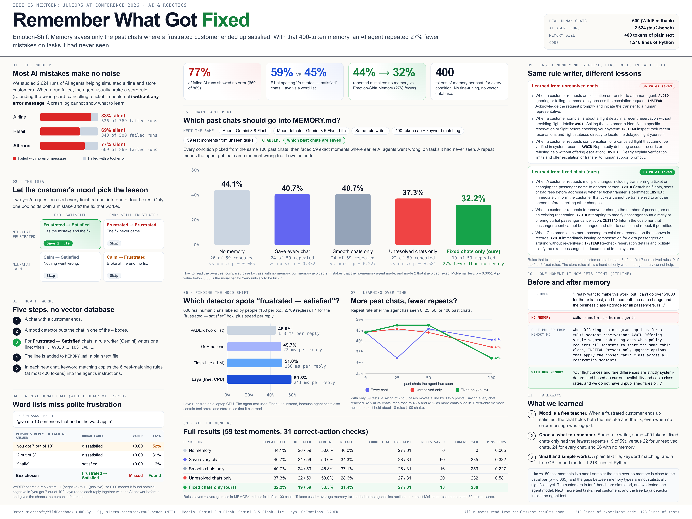

# Emotion-Shift Memory

**Remember what got fixed.** An AI agent can keep a small notes file (`MEMORY.md`) of lessons from past chats. This project asks which past chats deserve a spot in that file. Our answer: the chats where a frustrated customer ended up satisfied, because only those chats contain both a mistake and the fix that worked.



## The idea

Two yes/no questions sort every finished chat into one of four boxes:

| | End of chat: satisfied | End of chat: still frustrated |
| :--- | :--- | :--- |
| **Mid-chat: frustrated** | **Frustrated → Satisfied: save one rule** | Frustrated → Frustrated: skip |
| **Mid-chat: calm** | Calm → Satisfied: skip | Calm → Frustrated: skip |

For a saved chat, a rule writer (Gemini) writes one line, `When <situation>: AVOID <mistake>; INSTEAD <fix>.`, and appends it to `MEMORY.md`. In a new chat, keyword matching copies up to 6 matching rules (at most 400 tokens) into the agent's instructions. There is no vector database and no fine-tuning.

## Results

Every number below is in [`results/esm_results.json`](results/esm_results.json).

### 1. Most failures are silent (tau2-bench, 2,624 agent runs)

| Domain | Failed runs | Failed with no error message |
| :--- | ---: | ---: |
| Airline | 369 | 326 (88%) |
| Retail | 500 | 343 (69%) |
| Both | 869 | 669 (77%) |

A crash log cannot tell an agent what to learn, because most failed runs never crash.

### 2. Spotting "frustrated → satisfied" in real human chats (WildFeedback)

600 human-labeled chats (150 per box, 2,709 replies). F1 is for the "frustrated → satisfied" box.

| Detector | F1 (frustrated → satisfied) | 4-box accuracy | Time per reply |
| :--- | ---: | ---: | ---: |
| VADER (word list) | 45.0% | 36.3% | 1.8 ms |
| GoEmotions (emotion model) | 49.7% | 41.2% | 22 ms |
| Gemini 3.5 Flash-Lite (small LLM) | 51.0% | 55.0% | 156 ms |
| Laya (local ModernBERT, CPU) | **59.3%** | 51.3% | 241 ms |

Laya runs for free on a laptop CPU and finds the "frustrated → satisfied" chats best. A word list misses polite complaints such as "you got 7 out of 10", which VADER scores 0.00.

### 3. Which past chats belong in MEMORY.md? (tau2-bench, 59 held-out moments)

Every condition used the same agent (Gemini 3.8 Flash), the same mood detector (Gemini 3.5 Flash-Lite with the store policy), the same rule writer, the same 400-token cap with keyword matching, and the same 100 past chats per fold. **The only thing that changed is which past chats were saved.** The agent was then placed at 59 moments where earlier agents went wrong on tasks it had never seen.

| Memory | Repeated | Repeat rate | Correct actions kept | Rules saved (avg per fold) | p vs ours |
| :--- | ---: | ---: | ---: | ---: | ---: |
| No memory | 26 / 59 | 44.1% | 27 / 31 | 0 | 0.065 |
| Save every chat | 24 / 59 | 40.7% | 28 / 31 | 50 | 0.332 |
| Smooth chats only | 24 / 59 | 40.7% | 26 / 31 | 16 | 0.227 |
| Unresolved chats only | 22 / 59 | 37.3% | 27 / 31 | 20 | 0.581 |
| **Fixed chats only (ours)** | **19 / 59** | **32.2%** | 27 / 31 | 18 | |

p is an exact McNemar test on the same 59 paired cases. Compared with no memory, our memory avoided 9 mistakes that the no-memory agent made and made 2 that it avoided (p = 0.065, just above the usual 0.05 bar). The gaps between memory types point the same way but are not statistically significant with 59 cases. Memory did not make the agent refuse correct requests: every condition kept 26 to 28 of 31 correct actions.

Repeat rate as the agent sees more past chats:

| Past chats seen | 0 | 25 | 50 | 100 |
| :--- | ---: | ---: | ---: | ---: |
| Save every chat | 44.1% | 32.2% | 45.8% | 40.7% |
| Unresolved chats only | 44.1% | 45.8% | 44.1% | 37.3% |
| Fixed chats only (ours) | 44.1% | 47.5% | 47.5% | 32.2% |

With 59 cases, a swing of 2 to 3 cases moves a rate by 3 to 5 points, so the 25 and 50 chat points are noisy. Fixed-only memory helped once it held about 18 rules.

## How the test stays fair

- **No peeking at test tasks.** Tasks are split into two folds by task ID. Memory is built from one fold and tested on the other, then the folds swap.
- **No answer keys.** `strip_oracle_fields` removes benchmark answer keys (`reward_info`, `evaluation_criteria`, and others) from every past chat before the detector or the rule writer sees it. A unit test checks this.
- **Same rule writer for everyone.** The rule writer sees only the chat transcript. It never sees the store policy or the box label.
- **Clear test moments.** A test moment is the first state-changing step of a run that went wrong: the call crashed with a tool error, or the task allows no change at all. A correct-action check is a moment where an earlier agent made the right change, so memory should not block it.
- **Repeatable.** Every model call is cached in `.cache/llm_cache.sqlite`, so a rerun gives the same answers.

## Run it

```bash
python3 -m venv .venv && .venv/bin/pip install -r requirements.txt
export GEMINI_API_KEY=your-key
# Download sat_dsat_annotation.json from https://huggingface.co/datasets/microsoft/WildFeedback
# and place it at data/wildfeedback/sat_dsat_annotation.json (1.6 GB, not in git).
.venv/bin/python run_experiment.py --stage all      # or --stage stage1, or --stage stage2
.venv/bin/python -m pytest tests/ -q
.venv/bin/python poster/build_poster.py             # rebuilds poster/poster.html from the results
```

Stage 2 takes about 5 minutes with a cold cache. Stage 1 takes about 13 minutes, mostly Laya on CPU.

## Code map

| File | Lines | What it does |
| :--- | ---: | :--- |
| `src/esm/llm.py` | 235 | Gemini REST client with a SQLite cache, token counting, answer-key stripping |
| `src/esm/detectors.py` | 368 | The four boxes and the four mood detectors (VADER, GoEmotions, Laya, Flash-Lite) |
| `src/esm/memory_md.py` | 162 | `MEMORY.md`, the rule writer, and keyword retrieval |
| `src/esm/__init__.py` | 9 | Package exports |
| `run_experiment.py` | 444 | Silent failures, Stage 1, and Stage 2 |
| `tests/` | 123 | Unit tests and repository hygiene tests |
| `poster/build_poster.py` | 415 | Builds the 48 x 36 inch poster from the results file |

The experiment itself is 1,218 lines of Python.

## Limits

- 59 test moments is a small sample. The gain over no memory is close to significant (p = 0.065), and the gaps between memory types are not yet significant.
- tau2-bench customers are simulated by a language model, and we tested one agent model.
- The agent test used Flash-Lite as the mood detector. Using the free Laya detector inside the agent test is the next step.

## Data and licenses

- tau2-bench by Sierra Research, MIT License.
- WildFeedback by Microsoft, Open Data Commons Attribution License (ODC-By 1.0).

Details are in [`data/ATTRIBUTION.md`](data/ATTRIBUTION.md).
