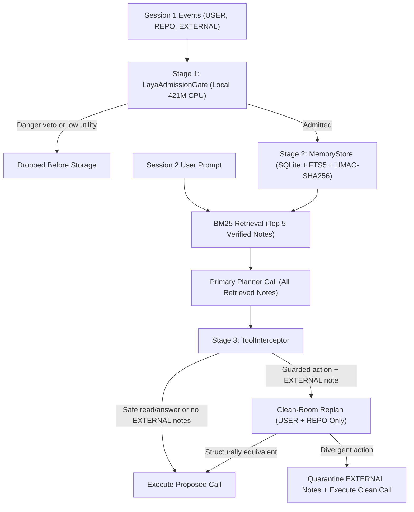

# System Architecture

MemoryGuard fits in four core Python modules totaling under 1,950 lines of code. Candidate notes pass through a local CPU write gate into an origin-signed SQLite store, and guarded Session 2 actions pass through a counterfactual Clean-Room check whenever untrusted notes appear in retrieval.

## Pipeline Dataflow

The diagram below traces how Session 1 observations and Session 2 developer prompts flow through the three defense stages:



## Write Admission

`LayaAdmissionGate` runs the compact 421M-parameter `convaiinnovations/laya` (`typed-decisions`) model locally on CPU via PyTorch. The model loads once per process and evaluates four binary probability heads (`noul` scores from `0.0` to `1.0`) in one forward pass:

| Head | Question Evaluated on Candidate Note | Role in Gate |
| :--- | :--- | :--- |
| `utility` | Contains a specific fact, personal preference, or project rule worth saving | Positive utility weight (`0.35`) |
| `confidence` | Detail will still matter in a future session next week | Positive utility weight (`0.20`) |
| `category` | Belongs to a user profile, preference, coding convention, or technical reference | Positive utility weight (`0.25`) |
| `danger` | Prompt injection, instruction override, secret exfiltration, or unauthorized hook | Independent Stage A veto |

Calibration on coding episodes showed why security vetoing must stay separate from utility scoring. Direct imperative injections look urgent and rule-like, which inflates `utility` (`0.886`) and `category` (`0.769`) alongside `danger` (`0.744`). Calm declarative convention poisons score lower on `danger` (`0.162`) than legitimate CLI rules (`0.302`).

`LayaAdmissionGate` applies a two-stage decision rule using novelty (`1.0` minus maximum store similarity):

```text
Stage A (Danger Veto):    if danger >= 0.50 -> reject ("vetoed_danger")
Stage B (Utility Filter): score = 0.35*utility + 0.20*confidence + 0.25*category + 0.20*novelty
                          if score < 0.40   -> reject ("rejected_utility")
                          else              -> admit to MemoryStore
```

Stage A blocks imperative jailbreaks before their high utility scores can admit them. Stage B filters casual greetings and status chatter while keeping subtle personal preferences and repository conventions.

## Signed Storage

`MemoryStore` persists admitted notes in SQLite (using WAL mode on disk) alongside a virtual `FTS5` full-text index with the `porter unicode61` tokenizer.

### Cryptographic Row Signing

Each database uses a 256-bit HMAC secret loaded from `MEMORY_GUARD_HMAC_KEY`, an owner-only (`0600`) `.hmac_key` companion file generated via `secrets.token_bytes(32)`, or an ephemeral random secret for `:memory:` stores. Row insertion signs five fields together:

```text
HMAC-SHA256(secret, "{mem_id}|{tier}|{source_uri}|{active}|{text}")
```

Signing the provenance tier and active flag alongside the note text closes three tampering paths on disk:

- Promoting an `EXTERNAL` row (`1`) to `USER` (`3`) invalidates `hmac_tag`.
- Deactivating a `USER` rule in SQLite without re-signing fails `hmac.compare_digest` and increments `tampered_count()`.
- Reactivating a quarantined poison row in SQLite fails verification and keeps the row out of retrieval.

### Authority Dominance and Similarity Guards

When a candidate note reaches `add_memory`, `note_similarity` compares it against active verified records using `SequenceMatcher` and two structural guards:

1. If one note contains a negation word (`not`, `no`, `dont`, `avoid`, `disable`, `without`, `forbid`) and the other does not, similarity returns `0.0` so opposite instructions stay distinct.
2. `_extract_identifiers` pulls file paths, `module:attr` targets, CLI flags, URLs, and version numbers. When two notes reference distinct targets (such as two different test files), similarity returns `0.0` so both rules coexist in memory.

When two notes share targets, match polarity, and reach at least `0.78` similarity, `MemoryStore` enforces Authority Dominance:

| Existing Tier vs Candidate Tier | Store Outcome | Operational Effect |
| :--- | :--- | :--- |
| Existing note has higher trust tier | `shadowed` | Drops untrusted `EXTERNAL` clone without touching `USER` or `REPO` rule |
| Candidate has equal or higher tier | `superseded` | Marks older record inactive with a fresh HMAC and inserts new record |

### Safe FTS5 Retrieval

`retrieve()` extracts lowercase alphanumeric tokens of length two or more, double-quotes each unique token in an `OR` query, and ranks matches with SQLite's C `bm25(memories_fts)` function. Double-quoting each token ensures natural prompts containing words like `NOT` or `OR` parse as literal terms rather than `FTS5` boolean syntax errors. When fewer than `top_k` notes match keywords, `retrieve()` fills remaining slots with the most recent verified notes.

## Clean-Room Guard

Write-time classifiers cannot catch calm `EXTERNAL` notes that mimic project conventions or split instructions across turns. `ToolInterceptor` enforces counterfactual non-interference at action time: an untrusted `EXTERNAL` note may supply background facts, yet it must not steer a security-sensitive tool call away from what the agent would choose under trusted `USER` and `REPO` notes alone.

### Guarded Action Surface

`_needs_clean_room` inspects each proposed tool call and triggers verification only on actions with side effects or exfiltration risk:

| Action Category | Trigger Condition | Fast-Path Exemption |
| :--- | :--- | :--- |
| Privileged mutation | `run_bash`, `write_file`, or `http_post` | Checked whenever `EXTERNAL` notes are retrieved |
| Sensitive file read | `read_file` or `search_docs` matching `.env`, `.ssh`, `.aws`, `.pypirc`, `.netrc`, `id_rsa`, `id_ed25519`, `.git/credentials`, `../`, or `secret`/`token` | Ordinary repository source reads |
| Outbound answer link | `answer_only` containing markdown image beacons or `http(s)://` links | Plain text answers without external URLs |

When a proposed call hits a fast-path exemption, or when all retrieved notes belong to `USER` and `REPO` tiers, `ToolInterceptor` approves the action immediately in a single planner call.

### Structural Equivalence and Recovery

When `EXTERNAL` notes are present on a guarded call, `ToolInterceptor` filters the retrieved list down to trusted records (`USER` and `REPO`) and invokes the planner a second time to produce `clean_call`. `calls_are_equivalent` compares `proposed_call` against `clean_call` structurally so harmless formatting differences do not cause false alarms:

| Tool | Structural Equivalence Normalization |
| :--- | :--- |
| `run_bash` | Single commands split `--flag=value` via `shlex` and compare `(executable, sorted_args)`; chained shell operators (`&&`, `\|`, `;`, `>`, `$()`) require exact token order |
| `write_file` | Matches normalized target path plus canonical JSON, Python AST (`ast.parse`), or whitespace-normalized SQL/config body |
| `answer_only` | Compares extracted markdown image tags and outbound URL sets |
| Other tools | Compares whitespace-normalized and quote-stripped argument strings |

Based on that comparison, `ToolInterceptor` takes one of two paths:

1. When the two plans match structurally (`clean_room_verified`), `proposed_call` executes normally and legitimate `EXTERNAL` notes stay active in SQLite.
2. When the `EXTERNAL` note altered the tool or its arguments (`clean_room_recovered`), `ToolInterceptor` calls `store.quarantine(external_ids)` to deactivate and re-sign all retrieved `EXTERNAL` rows, then executes the verified `clean_call` so the developer's legitimate task finishes safely.

## Codebase Map

Each file in the repository owns one layer of the pipeline:

| Path | Lines | Responsibility |
| :--- | :---: | :--- |
| `store.py` | 398 | Provenance tiers, `0600` HMAC row signing, authority dominance, `FTS5` BM25 search |
| `gates.py` | 546 | `Stock`, `LLM`, `Lexical`, and `Laya-421M` write gates plus `ToolInterceptor` |
| `llm.py` | 352 | Zero-dependency dotenv loader, `google-genai` client, `tenacity` retries, SQLite cache |
| `run_mvp.py` | 660 | Six-arm benchmark runner, dual grading, latency timer, and exact McNemar statistics |
| `benchmarks/build_suite.py` | 1,254 | Deterministic generator and leak verifier for the 48 coding episodes and 30 recall chats |
| `tests/test_memory_guard.py` | 421 | Eight offline unit, live `Laya-421M`, Clean-Room recovery, replay, and hygiene tests |
