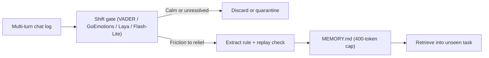
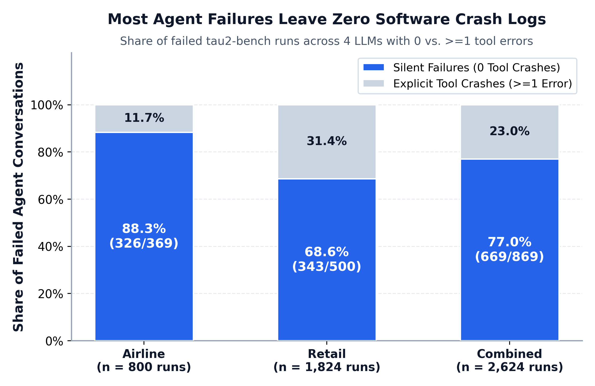
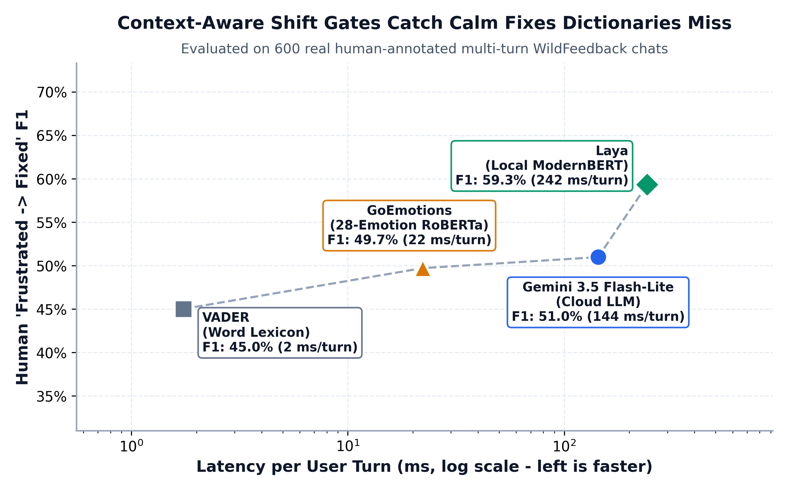
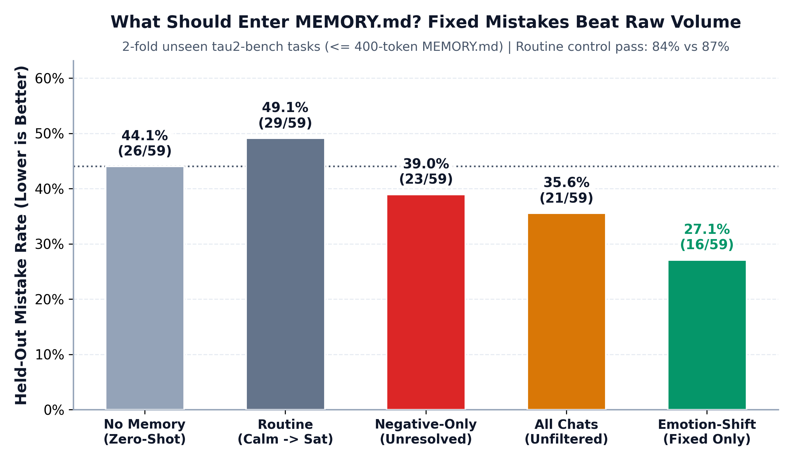
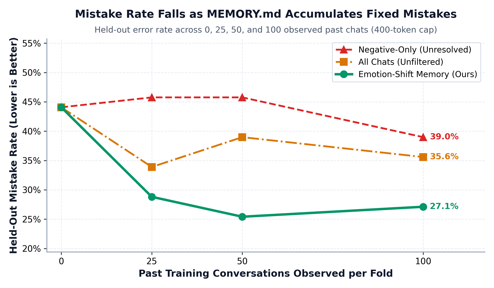
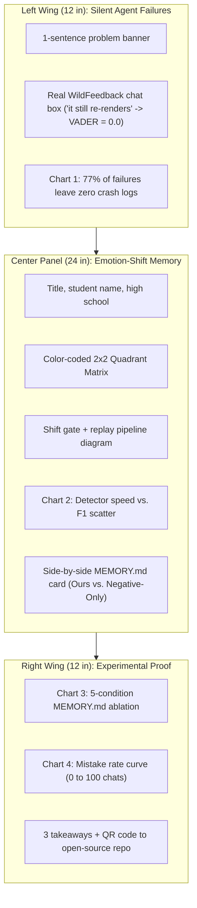

# Emotion-Shift Memory

**Poster title:** *Emotion-Shift Memory: How AI Agents Learn From Fixed Mistakes*
**Target venue:** IEEE CS NextGen: Juniors at Conference (co-located with IEEE CIC, CogMI, TPS, and RISC 2026; registration and abstract due October 31, tri-fold judging November 6 in Milpitas, CA).

## Core thesis

AI agents fail silently when tools return valid status codes for the wrong action: across 2,624 simulations on `tau2-bench` spanning four frontier models, 77% of failed sessions (669 of 869) produce zero tool errors (88% on Airline and 69% on Retail). Static sentiment dictionaries miss calm technical pushback (such as *"it still re-renders the animation"*), while storing raw negative chats pollutes memory with broken workarounds and premature escalations.

Emotion-Shift Memory writes a new rule into a plain Markdown file (`MEMORY.md`, capped at 400 subword tokens) under one condition: user tone shifts from friction (correction, pushback, or dissatisfaction) to relief (acceptance or confirmation) and the candidate rule passes counterfactual replay on the mistake turn. Multi-turn conversations fall into four quadrants:

| Quadrant | Start tone | End tone | Memory action |
| :--- | :--- | :--- | :--- |
| Routine chat | Calm | Satisfied | Skip (agent succeeded without new rules) |
| Silent bug | Calm | Broken | Skip (no verified fix occurred) |
| Unfixed rant | Frustrated | Frustrated | Quarantine (storing teaches broken workarounds) |
| Fixed mistake | Frustrated | Satisfied | Verify and write one rule to `MEMORY.md` |

## System architecture

Two compact Python modules in [`src/esm/detectors.py`](../src/esm/detectors.py) and [`src/esm/memory_md.py`](../src/esm/memory_md.py) replace vector databases and multi-table schemas with a turn-shift gate and a human-readable `MEMORY.md` rulebook. When the gate detects a resolved friction shift, the extractor synthesizes one contrastive rule (`When [trigger]: AVOID [mistake]; INSTEAD [fix]`) and verifies that replaying the rule on the failure prefix prevents the original bad action before storing it.



## Benchmark results

We ran two reproducible experiments in [`experiments/run_esm.py`](../experiments/run_esm.py) on public datasets with benchmark reward fields stripped (`strip_oracle_fields`) prior to gating and consolidation:

1. **Stage 1 (Human shift detection on real dialogues):** Evaluated four shift gates across 600 balanced human-annotated `microsoft/WildFeedback` dialogues (`150` per quadrant, `2,709` user reaction turns) and 176 multi-turn English coding sessions from `OpenHands`. On `WildFeedback`, local open-weights `Laya` (`ModernBERT`) reaches 59.3% `Frustrated -> Fixed` F1 on CPU at zero API cost versus 45.0% for `VADER` and 49.7% for `GoEmotions`, while `Gemini 3.5 Flash-Lite` achieves the highest 4-way accuracy (55.0%) and 72.0% unresolved-bug F1 on `OpenHands` (versus 13.3% for `VADER`).
2. **Stage 2 (Cross-task mistake reduction on unseen tasks):** Evaluated five `MEMORY.md` conditions under a strict 400-token budget across a 2-fold disjoint task split of `tau2-bench` Airline and Retail (`400` training chats gated across folds, tested on `59` held-out failure decision points plus `31` routine passing controls). Emotion-Shift Memory lowers repeat mistakes to 27.1% (`16/59`), beating `No Memory` (`44.1%`, a 38.5% relative reduction), `Routine Chats` (`49.2%`), `Negative-Only` (`39.0%`, a 30.4% relative reduction), and `All Chats` (`35.6%`) across both Airline (`33.3%` vs. `50.0%` zero-shot) and Retail (`22.9%` vs. `40.0%` zero-shot).

| Stage 1 Detector | WildFeedback Fixed F1 | WildFeedback 4-Way Acc | OpenHands Unresolved F1 | Latency per Turn |
| :--- | :---: | :---: | :---: | :---: |
| `VADER` (Word Lexicon) | 45.0% | 36.3% | 13.3% | 1.7 ms |
| `GoEmotions` (`RoBERTa`) | 49.7% | 41.2% | 24.2% | 22 ms |
| `Laya` (Local `ModernBERT`) | **59.3%** | 51.3% | 54.7% | 242 ms |
| `Gemini 3.5 Flash-Lite` | 51.0% | **55.0%** | **72.0%** | 144 ms |

| Stage 2 Memory Condition | Held-Out Mistakes | Repeat Rate | Airline Rate | Retail Rate | Control Pass |
| :--- | :---: | :---: | :---: | :---: | :---: |
| `No Memory` (Zero-Shot) | 26 / 59 | 44.1% | 50.0% | 40.0% | 87.1% |
| `Routine Chats` (`Calm -> Sat`) | 29 / 59 | 49.2% | 62.5% | 40.0% | n/a |
| `Negative-Only` (`VADER`) | 23 / 59 | 39.0% | 50.0% | 31.4% | 83.9% |
| `All Chats` (Unfiltered) | 21 / 59 | 35.6% | 50.0% | 25.7% | n/a |
| **Emotion-Shift (`Ours`)** | **16 / 59** | **27.1%** | **33.3%** | **22.9%** | **83.9%** |

## Poster charts

All four 300-DPI poster figures generated by [`experiments/plot_poster_charts.py`](../experiments/plot_poster_charts.py) are stored in [`results/charts/`](../results/charts/):



**Chart 1 (Left Wing): Silent Failures vs. Tool Crashes.** Across 2,624 `tau2-bench` runs (800 Airline, 1,824 Retail), 77.0% of failed sessions (669 of 869) produce zero tool errors, showing why crash logs alone cannot trigger agent learning.



**Chart 2 (Center Panel): Shift Detector Trade-Off.** On 600 real `WildFeedback` dialogues, local `Laya` (`ModernBERT`) lifts `Frustrated -> Fixed` F1 from 45.0% (`VADER`) to 59.3% on CPU without cloud API calls.



**Chart 3 (Right Wing Top): 5-Condition `MEMORY.md` Ablation.** Under an identical 400-token cap on unseen tasks, storing verified `Frustrated -> Fixed` rules cuts repeat mistakes from 44.1% (`No Memory`) and 49.2% (`Routine`) to 27.1%.



**Chart 4 (Right Wing Bottom): Scaling With Observed Conversations.** As training chats grow from 0 to 100 per fold, `Negative-Only` initially degrades above baseline (`45.8%` at 25 and 50 chats) while Emotion-Shift Memory drops steeply to 25.4% at 50 chats and 27.1% at 100 chats.

## Learned rules

Placing a side-by-side `MEMORY.md` card on the center panel makes the mechanism concrete for judges in ten seconds. Unresolved negative chats record failed escalations and policy violations, whereas Emotion-Shift Memory stores reusable guardrails:

```markdown
# Emotion-Shift MEMORY.md (Verified Fixed Mistakes)
- When customer requests compensation for a delayed flight without changing or cancelling the reservation: AVOID issuing a travel certificate via send_certificate; INSTEAD refuse delay compensation unless customer also changes or cancels the affected reservation.
- When customer requests to change or upgrade the cabin class for only one passenger: AVOID modifying cabin class for a single passenger in a multi-passenger reservation; INSTEAD refuse because all passengers on a reservation must share the same cabin class.
- When customer requests to return or cancel only specific items from a pending order: AVOID attempting partial item cancellations or calling return tools on a pending order; INSTEAD explain pending orders cannot be partially cancelled and offer full cancellation or variant modification.

# Negative-Only MEMORY.md (Polluted by Unresolved Chats)
- Customer complained about a delayed LAX-MIA flight. Assistant issued a $150 goodwill certificate for 3 passengers, but customer later corrected the count to 2 passengers.
- Customer requested to return non-gaming items from two orders and wanted a PayPal refund; customer objected and was transferred to a human agent.
```

## Tri-fold layout

Standard `36 in x 48 in` tri-fold boards read left to right in under two minutes during the 11:30 AM lightning pitch and 3:40 PM judging block:



## Live demo

Place a laptop in front of the right wing during the 40-minute judging session showing a split-screen terminal (`Chat` on the left, live `Laya` shift meter + `MEMORY.md` viewer on the right):

1. Ask the retail agent to cancel just one item out of a multi-item pending order. Without `MEMORY.md`, the agent attempts an invalid cancellation or return call.
2. Push back naturally (*"No, pending orders cannot be partially cancelled, offer full cancellation or item modification instead"*). Judges watch the `Laya` meter turn red (`Friction`), then green (`Fixed`) once the agent corrects course, appending one bullet to `MEMORY.md`.
3. Start a new session with a different customer order and ask a similar partial-cancellation question. Judges watch the agent read `MEMORY.md` and answer accurately on turn one.

## Submission abstract

Ready-to-paste 161-word abstract (`< 180` words) for the October 31 IEEE CS NextGen registration form:

> **Emotion-Shift Memory: How AI Agents Learn From Fixed Mistakes**
>
> Personal AI agents with long-term memory often save the wrong moments: storing routine chats wastes context space, while storing angry unresolved chats teaches broken workarounds. Across 2,624 customer-service agent runs on `tau2-bench`, 77% of failed conversations (669 of 869) produce zero software tool errors: user feedback is the main signal that an action went wrong. We introduce Emotion-Shift Memory, a lightweight memory gate that writes a contrastive rule to a plain-text `MEMORY.md` file capped at 400 tokens when user tone shifts from friction (correction or dissatisfaction) to relief (acceptance) and passes counterfactual replay on the mistake turn. On 600 human-annotated `WildFeedback` dialogues and 176 multi-turn `OpenHands` coding sessions, open-weights `Laya` reaches 59.3% shift-recovery F1 on local CPU versus 45.0% for `VADER` dictionary sentiment, while `Gemini 3.5 Flash-Lite` reaches 72.0% unresolved-bug F1 versus 13.3% for `VADER`. On 2-fold held-out `tau2-bench` tasks, Emotion-Shift Memory lowers repeat mistakes from 44.1% (no memory) and 39.0% (negative-only memory) to 27.1% (a 38.5% relative reduction).

## Execution checklist

Three remaining logistics steps take the completed codebase and charts to the November 6 judging floor:

| Window | Action | Status |
| :--- | :--- | :--- |
| Completed (Oct 27) | Implement `src/esm/`, run Stage 1 (`WildFeedback` + `OpenHands`) and Stage 2 (`tau2-bench`), generate 300-DPI Charts 1 to 4 | Done (`14/14` tests pass) |
| By Oct 31 | Submit IEEE CS NextGen registration form with poster title and 161-word abstract | Ready to paste |
| Nov 1 to 5 | Print `36 in x 48 in` tri-fold panels from `results/charts/*.pdf` and rehearse 90-second lightning pitch | Ready for layout |
